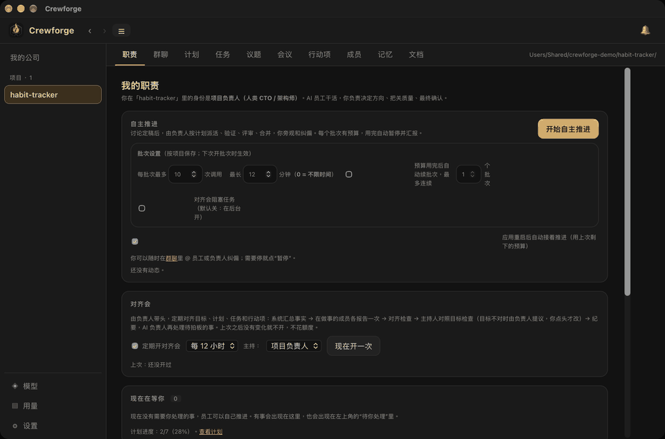
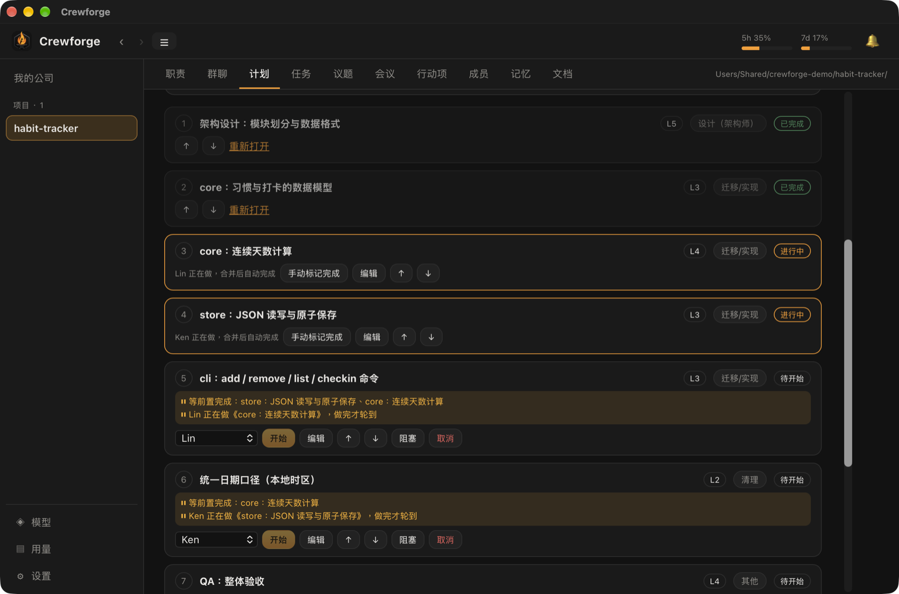
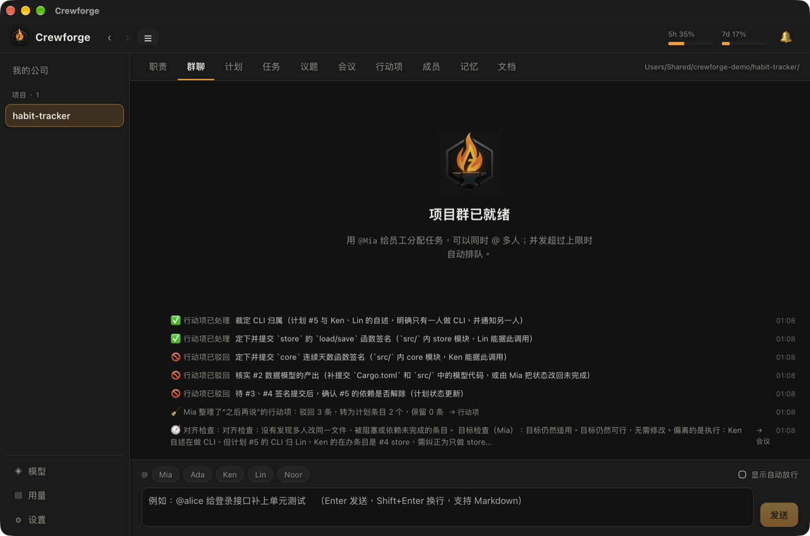
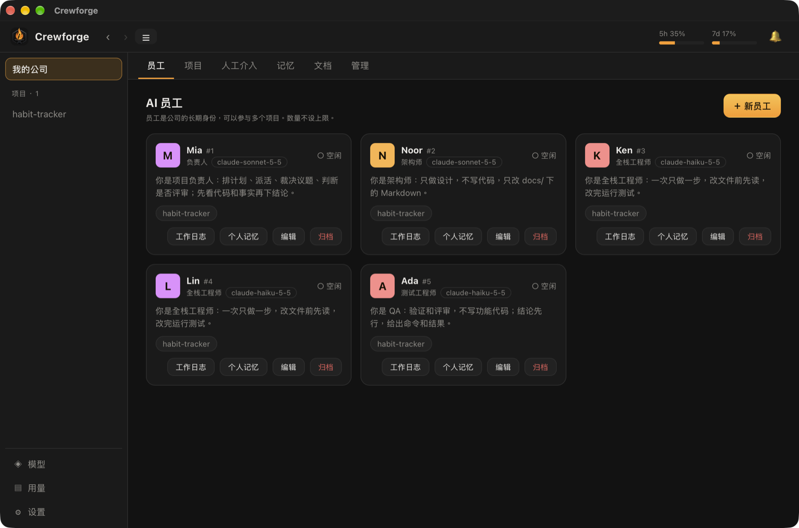
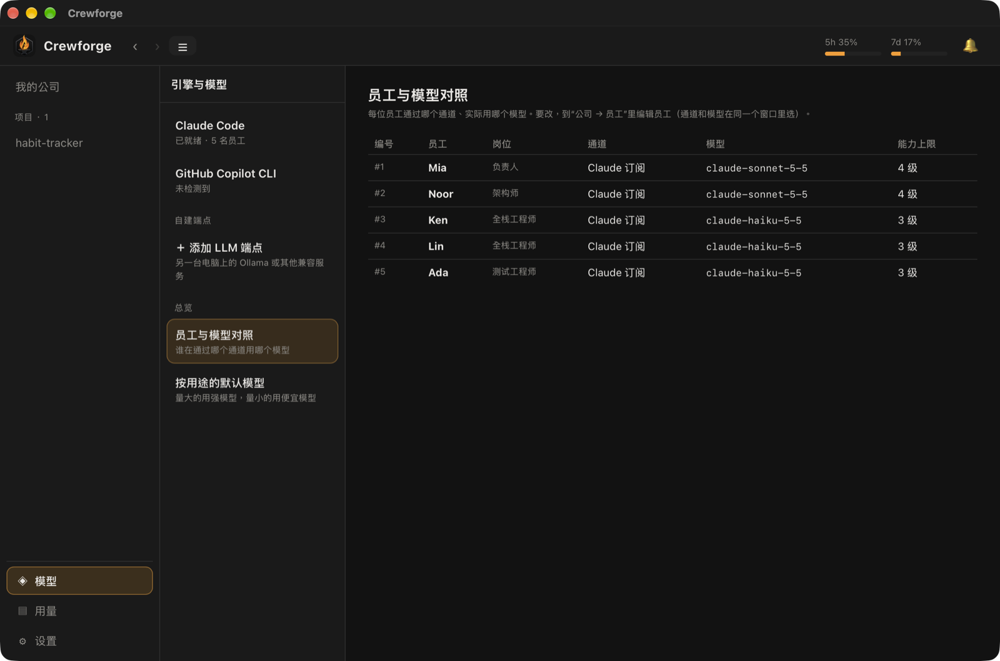

# Crewforge

**在你的 Mac 上，用一队 AI 员工长期协作开发软件。**

Crewforge 是一个 macOS 本地桌面应用。你创建项目和 AI 员工，员工是 [Claude Code](https://docs.claude.com/en/docs/claude-code) 或 GitHub Copilot 的命令行子进程；他们各自在独立的 git 工作区里写代码、跑测试、互相评审，由一位负责人（可以是 AI）排计划、派活、合并。你只在关键处介入：批准目标变更、危险命令和预算。

> 状态：早期版本（0.1），仅在 macOS 上使用和验证。界面、日志和文档以中文为主。

## 界面一览

> 截图和动图来自一个演示项目（命令行习惯打卡工具），数据不是真实项目。

**自主推进（约 40 秒的延时录屏，真实运行）：** 开始批次 → 两位开发并行、后面的条目等前置 → 评审 → 合并 → 冲突时负责人指挥合并。



**计划：** 条目有依赖、等级和指派；没满足前置的条目会写明在等什么。



**群聊：** 项目的主时间线，员工汇报、负责人整理行动项、对齐检查都在这里。



**员工与模型：** 每位员工有自己的角色、模型和能力上限，可以混用订阅模型和自建端点。




## 它能做什么

- **一个团队，多种角色：** 负责人、开发、QA、评审、架构师。每个角色有各自的职责和权限。
- **自主推进：** 负责人按计划的依赖关系派活，员工并行开发，完成后评审、合并、整理记忆、更新文档；失败时负责人调整计划。
- **先设计后实现：** 有架构师时，先产出设计文档，再由负责人按设计起草实现计划。
- **按能力派活：** 任务分 1–5 级，员工有能力上限，难的活派给强的模型，简单的活派给便宜的模型。
- **需求、Bug、排期一体：** 需求同时有业务面和技术面；QA 记的 Bug 自动生成修复和复测条目；新活先进「未排期」，有人空闲时由负责人统一排期，自主推进只派已排期的。
- **文档随时间演进：** 固定五份项目文档加每个需求一份规格文档，每份都有基于 git 历史的版本列表。
- **定时器与公司总览：** 预置的检查类定时任务（默认关闭，由你启用）；总览页一眼看出哪个项目需要你。
- **本地模型也能当员工：** 员工可以连局域网里的 Ollama 等 Anthropic 兼容服务，不占订阅额度。
- **一切可观察：** 工作日志、群聊、会议、议题板、计划页、用量统计都由同一条事件流汇总出来。
- **本地优先：** 数据在本机 SQLite 和 git 仓库里，没有云端服务和账号体系。

## 和其他工具比

Crewforge 不是 Claude Code 的替代品：它的员工**就是** Claude Code（或 Copilot CLI）的子进程，它在 CLI 之上加了一层团队管理。

| | 只用 Claude Code / Codex | Crewforge | Kiro | Copilot Projects |
|---|---|---|---|---|
| 一句话 | 一个 Agent（或几个并行会话）在终端里干活 | 长期运转的 AI 团队：角色、计划、评审、合并 | 规格驱动的 AI IDE | 给目标，由 Copilot 协调多个 Agent |
| 擅长 | 单个任务、交互式开发、快 | 有明确目标的中大型项目，少打扰地推进 | 先写规格再实现 | 已在 GitHub 的跨仓库工作 |
| 排活 | 你自己 | 负责人按依赖和等级派活 | 规格拆任务 | Copilot 协调 |
| 模型 | 各自官方模型 | 混用订阅和本地模型 | 以 Claude 为主 | 文档未写明 |
| 数据位置 | 本机 / 云端按产品 | 全部在本机 | 本机 IDE | 文档未写明 |
| 代价 | 轻量 | 有调度开销，仅 macOS，早期版本 | 付费档定价有争议 | 公开预览 |

小任务直接用 CLI 更快更省；任务多、有依赖、想长时间无人值守时，Crewforge 才划算。完整对比、取舍和信息来源见 [和其他工具的对比](docs/comparison.md)。

## 快速开始

前置条件：macOS、Rust（支持 edition 2024，即 1.85 以上）、较新的 Node.js、已安装并登录的 [Claude Code](https://docs.claude.com/en/docs/claude-code) CLI。

```sh
git clone <本仓库地址> crewforge && cd crewforge
npm install
npm run tauri dev          # 开发运行
# 或者构建并安装到 /Applications：
./scripts/install-mac.sh
```

第一次启动后：创建员工 → 新建项目并选一个 git 仓库 → 在「计划」页写目标 → 开启自主推进。完整步骤见 [快速开始](docs/getting-started.md)。

## 文档

| 文档 | 内容 |
|---|---|
| [快速开始](docs/getting-started.md) | 安装、首次配置、跑通第一个项目 |
| [和其他工具的对比](docs/comparison.md) | 对比 Claude Code / Codex、Kiro、Copilot Projects |
| [核心概念](docs/concepts.md) | 员工、角色、需求、计划、排期、任务、Bug、定时器、文档、记忆，以及它们的关系 |
| [功能总览与典型流程](docs/features.md) | 每个功能解决什么、怎么用、怎么触发；新项目 / 老项目 / Bug / 需求迭代的流程 |
| [使用指南](docs/user-guide.md) | 每个页面怎么用，常见操作 |
| [连接本地模型（Ollama）](docs/endpoints.md) | 自建端点的配置、并发和排错 |
| [常见问题与排错](docs/troubleshooting.md) | 员工卡住、没权限、数据库版本等 |
| [架构说明](docs/architecture.md) | 给贡献者：代码结构、事件主干、一次执行的流程 |
| [贡献指南](CONTRIBUTING.md) | 开发环境、测试、提交约定 |
| [产品设计与开发记录](docs/target.md) | 需求和按时间顺序的实现记录（每节写明验证了什么、没验证什么） |
| [开发场景流程图](docs/flows.md) | 各类场景的流程 |

## 项目结构

```
crates/core    全部业务逻辑（SQLite、git、调度、自主推进），不依赖 UI
crates/cli     crewforge 命令行；同时提供员工用的 mcp-serve 子命令
src-tauri      Tauri 2 外壳：命令封装 + 后台定时器
ui             React + TypeScript 界面
scripts        安装脚本
docs           文档
```

## 安全说明

员工是会运行命令、改文件的 AI 进程。Crewforge 的默认做法是：在系统沙箱里执行，工作区之外不可写，网络只通白名单域名，危险命令（提权、推送、远程登录等）必须由你批准。详见 [SECURITY.md](SECURITY.md)。

## 许可证

[MIT](LICENSE)。
