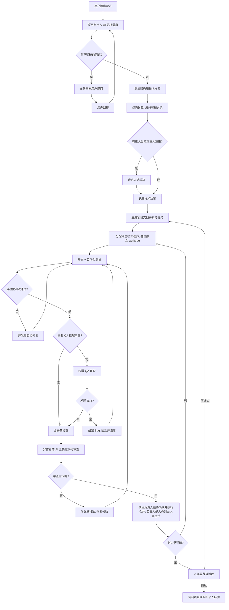
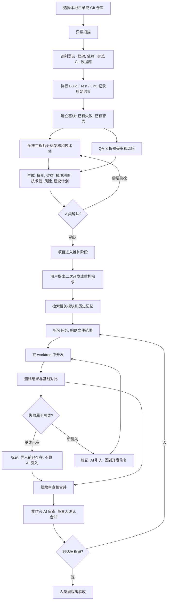
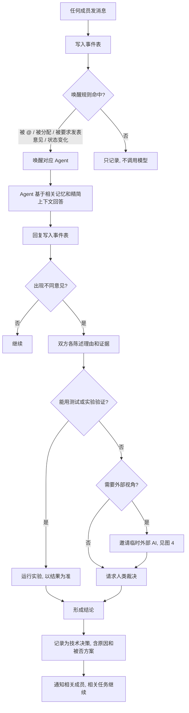
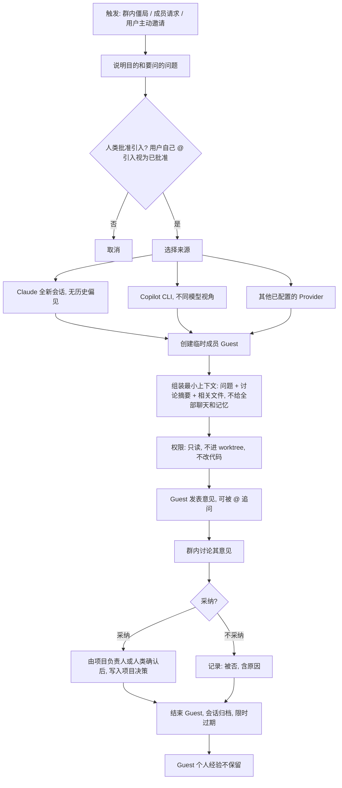
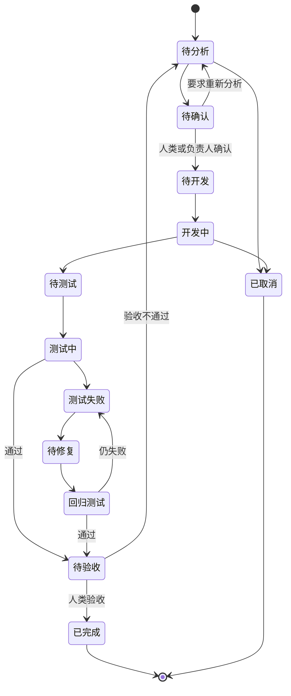
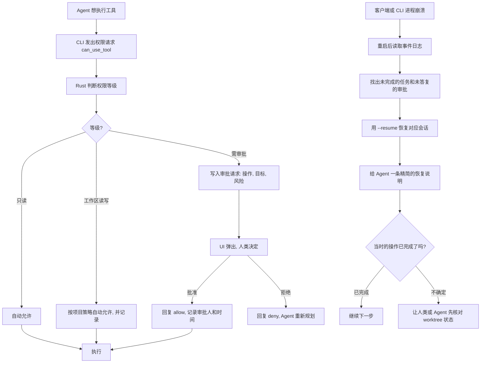
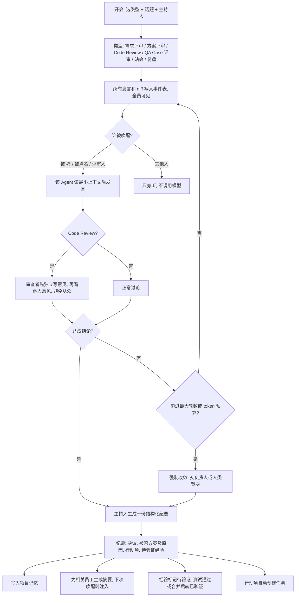
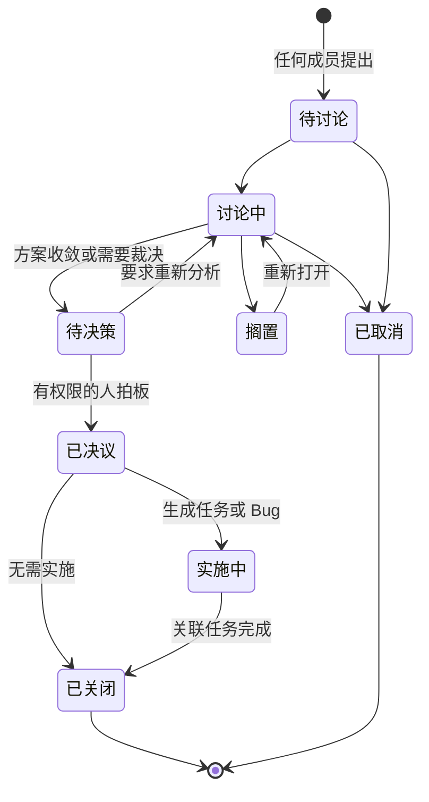

# 开发场景流程图（待确认）

确认后的结论将同步到 `target.md` 第 20 节。

## 1. 新业务开发

## 2. 旧项目导入和二次开发

## 3. 群聊讨论和遇到问题

## 4. 引入外部临时 AI

## 5. 任务和 Bug 生命周期

## 6. 高风险审批和崩溃恢复

## 7. 群 = 会议室（评审、站会、Code Review 都在群里进行）

## 8. 议题板（Issue）状态

议题被推翻时不改原记录，而是新建议题并标注"取代"。

## 已确认的决策

1. 用户可以在群里直接 @ 引入外部临时 AI，无需另走审批；成员或系统发起的引入仍需人类批准。
2. 工作区读写默认允许，仅越权操作弹窗审批。
3. 人类只在里程碑验收，不逐任务验收。
4. 合并流程：自动检查通过 → 非作者的 AI 全栈审查 → 有问题在群里讨论 → 通过后由项目负责人最终确认并执行合并；负责人是人类时由人类合并。负责人自己写的代码，同样由其他 AI 全栈审查。
